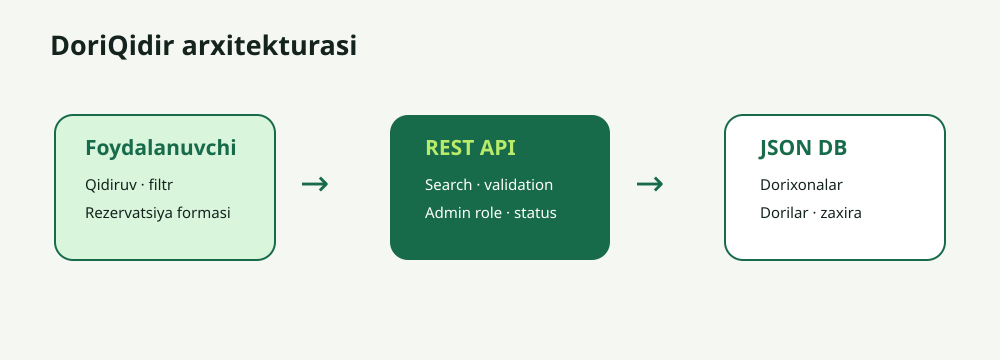

# DoriQidir

DoriQidir — Toshkentdagi dorixonalardan kerakli dori qayerda borligini tez topish va dorixonaga borishdan oldin telefon orqali ajratish uchun yaratilgan web-ilova. Muammo oddiy: odamlar dori izlab bir nechta dorixonani aylanadi, zaxira va narx haqida oldindan ma’lumot topa olmaydi. DoriQidir bu jarayonni bitta qidiruv va bitta rezervatsiya so‘roviga qisqartiradi.



## Imkoniyatlar

Foydalanuvchi dori nomi yoki faol modda bo‘yicha qidiradi, hududni tanlaydi va har bir dorixonadagi narx, manzil, telefon, ish vaqti hamda dona zaxirasini ko‘radi. Kerakli variant tanlangach ism, telefon va sonni yuborib, dorini oldindan ajratadi. Retsept talab qilinadigan dorilar katalogda alohida belgilanadi.

Dorixona xodimi demo admin kaliti orqali rezervatsiyalarni ko‘radi va holatini `new`, `confirmed`, `ready`, `collected` yoki `cancelled` qiymatlaridan biriga o‘zgartiradi. Bu keyinchalik dorixona akkauntlari, SMS xabarnoma va real ombor integratsiyasiga kengaytirish uchun tayyor oqimdir.

## Texnologiyalar

Loyiha dependency-free Node.js ES modules, built-in `http` server, REST/JSON API, semantic HTML, vanilla JavaScript va responsive CSS bilan qurilgan. Hozirgi demo ma’lumotlar bazasi JSON faylida saqlanadi; rezervatsiyalar server qayta ishga tushganda ham saqlanadi.

## O‘rnatish va ishga tushirish

Node.js 18 yoki undan yangi versiya kerak. Repository’ni yuklab, loyiha papkasiga kiring:

```bash
git clone https://github.com/RaximjonRaximov/doriqidir.git
cd doriqidir
cp .env.example .env
npm test
npm start
```

Brauzerda `http://localhost:3050` manzilini oching. `PORT`, `DATA_FILE` va `ADMIN_KEY` qiymatlarini `.env.example` asosida sozlash mumkin. Muhit o‘zgaruvchilarini avtomatik yuklash uchun production’da process manager yoki shell export ishlating.

## API

`GET /api/health` server holatini qaytaradi. `GET /api/areas` hududlar ro‘yxatini beradi. `GET /api/medicines?q=paratsetamol&area=Yunusobod` dorilarni qidiradi va har bir dorining dorixonalardagi zaxirasini qaytaradi.

`POST /api/reservations` quyidagi JSON bilan rezervatsiya yaratadi:

```json
{
  "medicineId": "m1",
  "pharmacyId": "p1",
  "quantity": 2,
  "customer": {"name": "Ali Valiyev", "phone": "+998901234567"}
}
```

Admin uchun `GET /api/reservations` va `PATCH /api/reservations/:id` endpointlari `x-admin-key` headerini talab qiladi. PATCH body misoli: `{ "status": "ready" }`.

## Foydalanish bosqichlari

Avval dori nomini kiriting va kerak bo‘lsa hududni tanlang. Natijadagi dorixona variantlarini narx va zaxira bilan solishtiring. “Ajratish” tugmasini bosib, ism, telefon va sonni kiriting. So‘rov yuborilgach dorixona xodimi mijoz bilan telefon orqali bog‘lanadi. Xodim panelini ko‘rish uchun yuqoridagi “Dorixona xodimi” tugmasidan foydalaning; demo kalit `demo-dori-admin`.

## Tekshiruv

`npm run lint` server va frontend JavaScript sintaksisini tekshiradi. `npm test` health check, qidiruv, admin himoyasi, rezervatsiya yaratish, admin ro‘yxati va status o‘zgarishini tekshiradigan 6 ta smoke testni ishga tushiradi. Test oxirida demo rezervatsiya avtomatik tozalanadi.

## Cheklovlar

Bu versiyada ma’lumotlar JSON faylida turadi, shuning uchun ko‘p serverli production uchun MySQL yoki PostgreSQL kerak bo‘ladi. Zaxira real vaqt ombor tizimidan olinmaydi, dorixona xodimi uni qo‘lda yangilashi kerak. To‘lov, SMS, retseptni tekshirish va alohida dorixona akkauntlari hali qo‘shilmagan. `x-admin-key` demo roli uchun mo‘ljallangan; production’da haqiqiy login, parol xeshlash, session va audit log joriy etilishi kerak.
